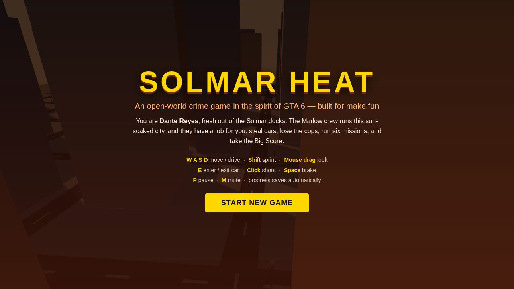
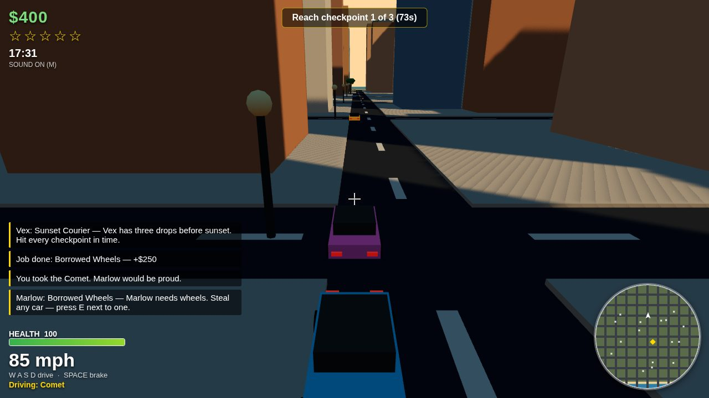
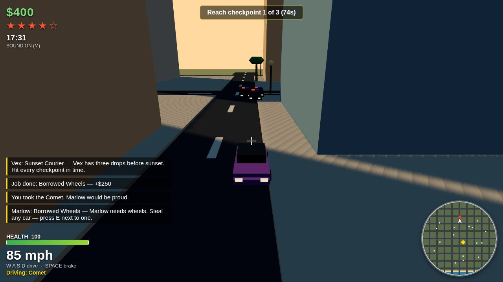
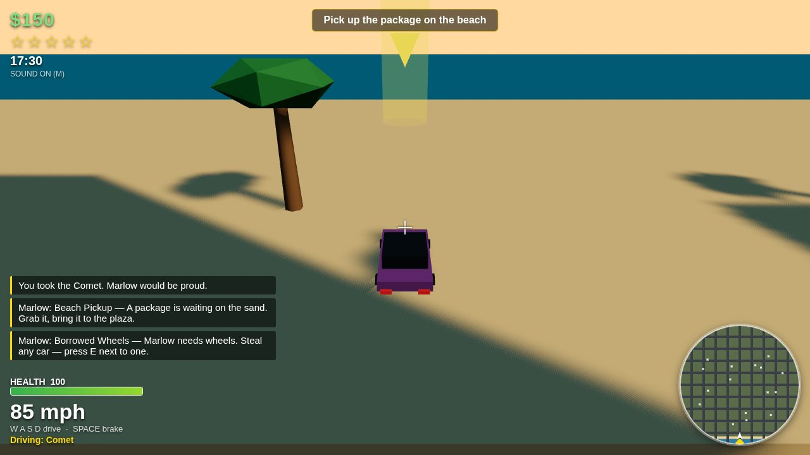

# Solmar Heat

[](https://make.fun/bounty/gta6-01?utm_source=github&utm_medium=readme&utm_campaign=gta6-01)
[](https://make.fun/bounty/gta6-01/leaderboard?utm_source=github&utm_medium=readme&utm_campaign=gta6-01)
[](https://make.fun/bounty/gta6-01?utm_source=github&utm_medium=readme&utm_campaign=gta6-01)

Solmar Heat is a complete open-world crime game in the spirit of GTA 6, built for the [make.fun gta6-01 bounty](https://make.fun/bounty/gta6-01). It runs entirely offline in a desktop browser, straight from static files — no network connection, no build step, and no account needed.

## The story

You are Dante Reyes, just out of the Solmar docks and back on streets that never forgot you. The Marlow crew runs this sun-soaked city, and they have work for a driver who can keep his cool: lift cars, shake the cops, run their jobs, and earn your way to the Big Score.

## The city

Solmar is a 9×9 grid of roads lined with towers, with a fountain plaza at its heart, a green park to wander, and a beach and open sea along the southern edge. Out on the shore stands a striped lighthouse, and rising above the skyline is the glass Solmar Trust tower — the one building everybody in town is either working for or running from.

## A living street

The city never stands still. Sixteen traffic cars cruise the avenues and turn at intersections, twenty-six pedestrians stroll the sidewalks and scatter when gunfire starts, fourteen cars sit parked and waiting, and three foot cops walk a beat through the blocks.

## Stealing cars

Walk up to any car and press **E** to climb in and drive off. It is that easy — and that risky. Lifting a ride right in front of the law puts heat on you, so pick your moment.

## Wanted

The law tracks you on a five-star scale. Police Interceptors chase you down and ram your car; foot cops run you down on the street. Keep your nose clean and the heat slowly fades away. Get caught and you are BUSTED — or WASTED if your health hits zero — and the fine takes $200 out of your pocket.

## Missions

Six jobs come in from Marlow and Vex, and each one pays:

1. **Borrowed Wheels** — Marlow
2. **Sunset Courier** — Vex, a timed run through checkpoints
3. **Hot Wheels** — Marlow, earn heat, then lose it
4. **The Getaway** — Vex
5. **Beach Pickup** — Marlow
6. **The Big Score** — Vex

Finish all six and the story is complete.

## Combat

On foot, click to fire the pistol. Shooting in front of witnesses adds heat, and dropping a cop adds it faster still — so every shot is a choice.

## HUD

Everything you need sits on screen: your cash, your wanted stars, the in-game clock, the current mission objective, your health, and a speedometer when you drive. A live circular minimap shows the roads, the sea, traffic, police, and the mission blip, so you always know where the trouble is.

## Title, pause, saving

A title screen greets you, **P** pauses the action, and the game saves itself automatically — your cash and mission progress are kept in localStorage, so coming back later offers you a Continue right where you left off.

## Polish

A third-person chase camera follows you through the streets under a golden-hour sun that throws long shadows across the roads. All sound is generated live with procedural WebAudio — the engine hum, the sirens, the gunshots, the little jingles when a mission lands — with no audio files at all.

## Tips for the streets

- Steal away from the cops' line of sight and the job stays quiet.
- A parked car is a free getaway — if nobody is watching.
- Losing the chase is half the job: break line of sight, then stay clean until the stars drop.
- Save your health for the Big Score. The fine for getting caught is always $200, but a failed run costs you the payout.

## How to play

```bash
node serve.ts
```

Then open http://localhost:8080 in a desktop browser.

| Key | Action |
| --- | --- |
| W A S D | Move / drive |
| Shift | Sprint |
| Mouse drag | Look around |
| E | Enter / exit car |
| Click | Shoot (on foot) |
| Space | Brake |
| P | Pause |
| M | Mute |

## Screenshots

The shots below were captured from the game itself with `?shot=` (shots.json, seed 7): the title over the plaza, a stolen car tearing down 20th Ave, a four-star police chase, and the Beach Pickup mission.






## Tech

The game is built on three.js 0.186.1, vendored as `game/vendor/three.min.js` (MIT). The code is plain ES modules under `game/src/`, one file per system — config, random, audio, city, vehicles, people, missions, hud, world, shots, and main. `main.ts` (Node 22) hands the game in using the kit's `vendor/makefun-game.ts`.

Everything here is original: the city, the characters, the vehicles, the names, the story, the art, and the sound. No Rockstar or GTA names, art, or assets are used.

## License

MIT — see [LICENSE](LICENSE).
